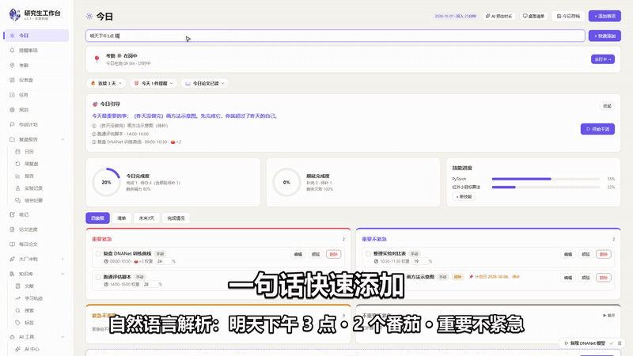
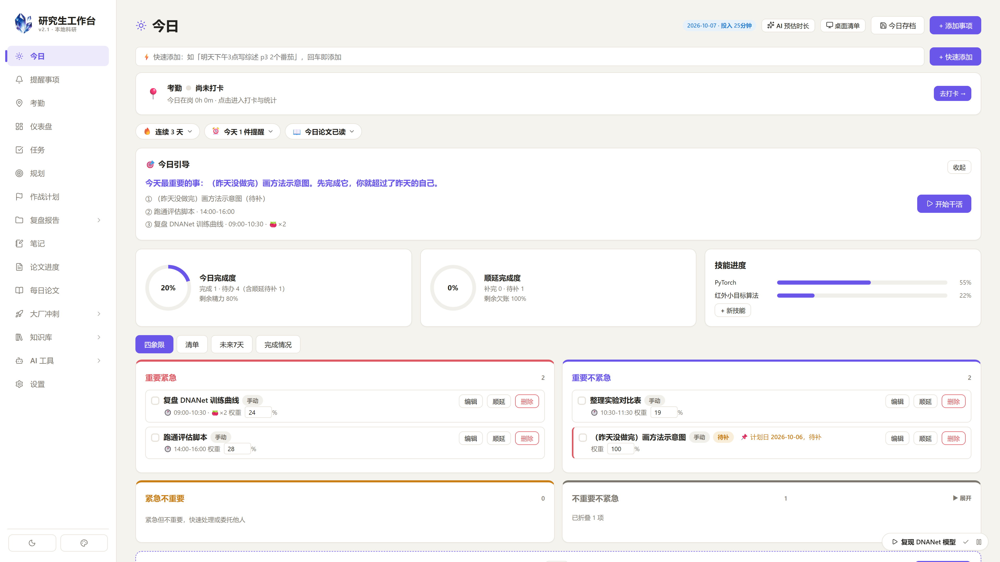
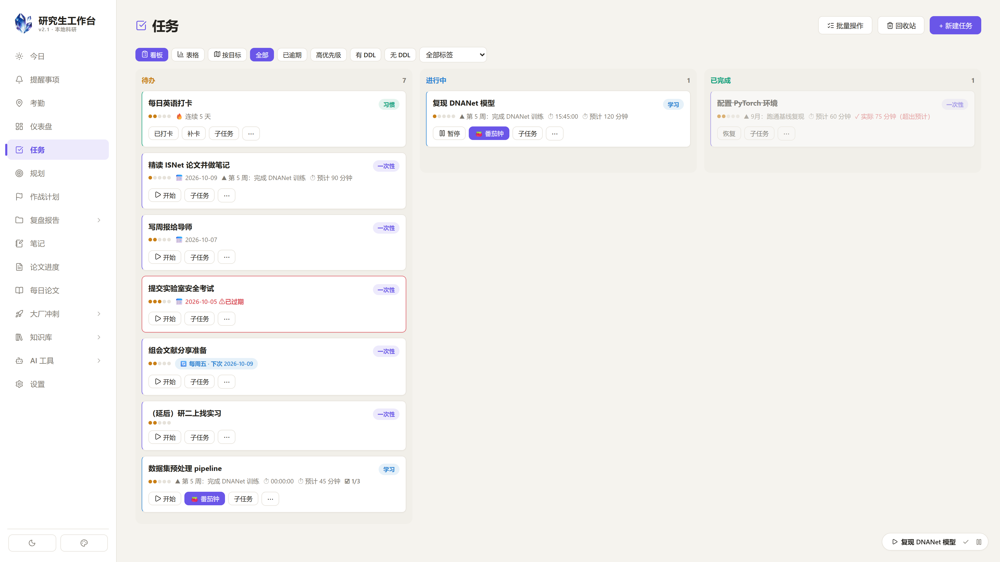
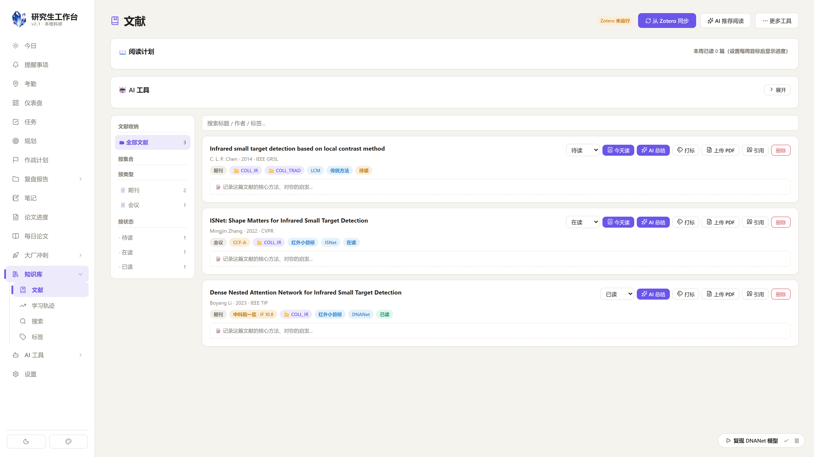
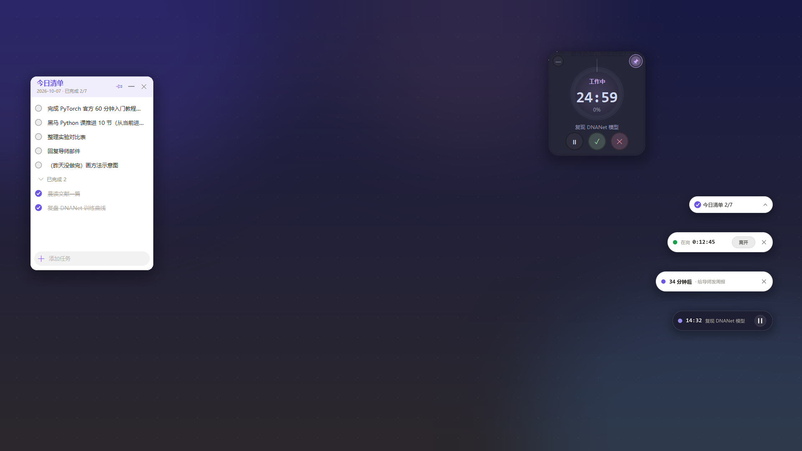

# Research Workbench · 研究生工作台

A local-first research workbench for graduate students: tasks, goals, notes,
Zotero literature, daily papers, reviews, statistics, and desktop widgets in one
place. Everything runs on your machine; AI and reference-manager integrations
are optional.

[](https://www.python.org/)
[](https://nodejs.org/)
[](LICENSE)
[](#status)



> The full 2m40s demo is available in the repository's Releases. The GIF above
> shows the global quick-add flow.

## English overview

Research Workbench is a single-user, local-first desktop/web app for managing
the practical side of research: daily planning, tasks and deadlines, notes,
Zotero literature, paper discovery, weekly reviews, attendance, and a small
statistics dashboard. The backend is FastAPI + SQLite; the frontend is React +
Vite; an optional pywebview shell adds a tray icon and always-on-top desktop
widgets. Data never leaves the machine unless you explicitly configure
DeepSeek, Zotero, or OpenAlex. API keys are encrypted with Windows DPAPI.

The project is Windows-first and currently in alpha. It is a long-running
personal project, now open-sourced so other students can use and improve it.

## 中文说明

这是一个本地优先的科研工作台：把读研期间分散在任务软件、笔记软件、文献
管理器、日历和计时器里的东西收进一个本地应用。默认不上传任何数据；只有你
主动配置 DeepSeek、Zotero 或每日论文检索时，才会访问对应服务。

项目目前以 Windows 10/11 为主，处于 alpha 阶段。它最初是作者自用的长期项目，
现在开源出来，希望帮到同样被“工具太多、数据太散”困扰的研究生。

## 界面

| 今日 | 任务看板 |
| --- | --- |
|  |  |

| 文献 | 桌面组件 |
| --- | --- |
|  |  |

更多截图见 [`docs/screenshots/`](docs/screenshots/)。

## 功能

- **今日**：四象限今日清单、自然语言快速添加、未来 7 天预览、AI 每日整理建议、
  今日引导卡、一句话顺延。
- **仪表盘**：投入时长、番茄数、90 天热力图、30 天趋势、任务耗时分布、毕业倒计时，
  卡片可拖动排序和调整大小。
- **任务**：看板 / 表格 / 按目标三种视图，列内拖动排序、批量操作、子任务、每周循环、
  回收站、过期高亮、搜索深链；习惯任务打卡、学习任务计时、一次性任务 DDL 与 AI 估时；
  系统级 DDL 提醒与周复盘提醒。
- **规划**：目标金字塔（年 → 季 → 月 → 周）、路线图视图、毕业倒计时、AI 规划助手
  （一句话 / 粘贴文本 / 优化已有 → 预览 → 批量保存）。
- **提醒事项**：一次性与每天 / 每周 / 每月循环、多次提前提醒、桌面弹窗 + 声音、
  与今日页和日历联动。
- **考勤**：到岗 / 离开 / 休息计时，忘记离开可事后修正，月度统计。
- **每日论文**：OpenAlex 检索领域前沿、AI 中文导览、一键加入今日清单 / 入库、
  自动推送 Zotero（题录 + PDF 附件）。
- **作战计划**：与手写 Markdown 规划文件夹双向同步（双击确认 + 写前备份）、
  一键导入、周复盘导出、导师周报草稿。
- **桌面组件**：悬浮今日清单、悬浮番茄钟、四个桌面胶囊（清单 / 考勤 / 提醒 / 番茄），
  可拖动、可换色、可开关。
- **周复盘 / 报告**：自动汇总本周 / 本月数据、AI 点评、一键存为笔记、统计“在岗 vs 专注”。
- **笔记**：Markdown、文件夹树、页内搜索、剪贴板图片粘贴 + 图片编辑（箭头 / 文字 /
  框选 / 画笔 / 裁剪 / 旋转）、AI 润色、本地 Whisper 语音录入、双向链接。
- **文献**：Zotero 在线 API 增量同步、AI 结构化总结 / 批量总结、文献库问答、
  AI 智能打标 / 批量打标 / 标签清理、阅读状态与阅读笔记、“今天读”加入今日清单、
  AI 推荐阅读、BibTeX 导出。
- **会议纪要**：AI 生成结构化纪要，历史纪要归档为笔记。
- **学习轨迹**：每天记录科研 / 技术收获，形成成长轨迹。
- **搜索 / 标签**：全局搜索任务、笔记、文献、目标；标签云聚合。
- **AI 中心**：AI 调用历史（展开 / 复制 / 清空）、通用对话（自动带科研画像 +
  知识库检索）。
- **求职三件套**：刷题记录（打卡连续天数）、面试八股（间隔重复复习）、
  投递管理（漏斗 + 时间线）。
- **设置**：DeepSeek API Key、Zotero 配置、主题切换（6 色系 + 自由调色盘）、
  六档字体、桌面胶囊配色、任务提醒开关、周复盘提醒、自动备份、Excel 导出、
  存储清理、开机自启。

## 技术栈

- 后端：Python + FastAPI + SQLite（SQLAlchemy）
- 前端：React + Vite
- 桌面壳：pywebview + pystray（系统托盘常驻）
- AI：DeepSeek API（在线，可选）、faster-whisper（本地语音转写，可选）
- 文献：Zotero 在线 API（可选）
- 每日论文：OpenAlex（可选）

```
┌──────────────────────────────┐
│  React + Vite (frontend)     │
└──────────────┬───────────────┘
               │ HTTP 127.0.0.1:8000
┌──────────────▼───────────────┐
│  FastAPI (backend/app)       │
│  routers + services          │
└───┬──────────┬───────────┬───┘
    │          │           │
 SQLite    DeepSeek     Zotero / OpenAlex
 (local)   (optional)   (optional)
    │
 backend/data (images, PDFs, audio, backups)

Desktop shell: pywebview + pystray + always-on-top widgets
```

## 快速开始

### 环境要求

- Windows 10/11
- Python 3.10+
- Node.js 18+
- Git

### 一键安装

```bat
git clone https://github.com/wangchenyi520/research-workbench.git
cd research-workbench
setup.bat
```

`setup.bat` 会创建 `.venv`、安装后端和桌面依赖、安装前端依赖并构建前端。

### 启动

```bat
start.bat          :: 浏览器模式，打开 http://127.0.0.1:8000
start_desktop.bat  :: 桌面模式，无黑框，关闭窗口最小化到托盘
stop.bat           :: 停止占用 8000 端口的后端
```

### 手动安装

```bat
python -m venv .venv
.venv\Scripts\activate
pip install -r backend\requirements.txt
pip install -r desktop-requirements.txt

cd frontend
npm ci
npm run build
cd ..

start.bat
```

### 首次配置

打开「设置」页：

| 配置项 | 说明 |
| --- | --- |
| DeepSeek API Key | 用于 AI 总结 / 写作 / 规划 / 每日整理；不填则 AI 功能不可用 |
| Zotero API Key + User ID | Zotero 桌面版 → 设置 → 高级 → API 生成；用于文献增量同步 |
| Self_analysis 规划文件夹 | 可选；指向你自己的 Markdown 规划目录，用于作战计划页 |
| 每日论文检索词 | 默认 `infrared small target detection`，改成你的研究方向 |

## 数据与隐私

- 默认数据目录：`backend/data/`（SQLite、图片、附件、PDF、音频、备份）。
- 所有数据都在本地；项目没有遥测、没有账号系统、没有云端同步。
- API Key 使用 Windows DPAPI 加密后存入本地 SQLite；设置页只显示掩码。
- 只有你主动使用以下功能时才会发起网络请求：
  - DeepSeek：AI 总结、规划、对话、每日整理；
  - Zotero：文献同步；
  - OpenAlex：每日论文检索；
  - 你手动输入的网址 / PDF 下载。
- **不要把 `backend/data/`、`.env`、数据库文件或日志提交到 Git。**

详见 [`docs/PRIVACY.md`](docs/PRIVACY.md)。

## 目录结构

```
backend/
  app/
    routers/      各功能 API（tasks/goals/notes/literature/reviews/stats/...）
    services/     DeepSeek / Zotero / Whisper / 提醒 / 备份 / 桌面悬浮组件
    main.py       FastAPI 入口
    models.py     SQLAlchemy 模型
    config.py     本地路径与环境变量
  requirements.txt
  tests/
frontend/
  src/
    pages/        功能页面
    components/   通用组件
    api.js        Axios 客户端
  package.json
desktop.py        pywebview + 托盘桌面壳
setup.bat         一键安装
start.bat         浏览器模式
start_desktop.bat 桌面模式
docs/             截图、架构、隐私、安装说明
```

## 开发

后端热重载：

```bat
cd backend
..\.venv\Scripts\python.exe -m uvicorn app.main:app --reload --port 8000
```

前端开发服务器（代理到 8000）：

```bat
cd frontend
npm run dev
```

测试与检查：

```bat
.venv\Scripts\python.exe -m pytest
python -m compileall -q backend\app
cd frontend && npm run build
```

CI 会在 Windows 上跑后端编译与测试，在 Ubuntu 上构建前端。

更多细节见 [`docs/SETUP.md`](docs/SETUP.md) 和
[`docs/ARCHITECTURE.md`](docs/ARCHITECTURE.md)。

## 状态与路线图

当前是 alpha：核心功能可用，但接口、数据库结构和 UI 仍可能变化。已知限制：

- Windows-first；Linux / macOS 尚未完整适配（DPAPI、托盘、悬浮窗、通知需要替代实现）。
- 单用户、本地单机；没有多端同步。
- 没有插件系统；新增功能通常需要改后端路由和前端页面。

路线图见 [`docs/ROADMAP.md`](docs/ROADMAP.md)。欢迎 issue 和 PR。

## 贡献

请先阅读 [`CONTRIBUTING.md`](CONTRIBUTING.md)。提交前请确保：

- 不包含个人数据、数据库、日志、API Key；
- 后端能通过 `pytest` 和 `compileall`；
- 前端能通过 `npm run build`；
- 新功能附带必要的文档或截图。

## License

MIT — 见 [`LICENSE`](LICENSE)。

## 致谢

FastAPI、SQLAlchemy、React、Vite、pywebview、pystray、Pillow、faster-whisper、
Zotero、OpenAlex，以及所有让本地优先工具变得可行的开源项目。
